<p align="center">
  <a href="LICENSE"></a>
  <a href="CHANGELOG.md"></a>
  
  
  
</p>

A skill that teaches Google AdSense approval end to end: the full
history from the 2003 launch to today, the current eligibility rules,
every policy layer, the mistakes that get sites rejected, and the
habits that keep an approved account safe.

Built for AI assistants (Muse, Claude Code, Cursor, and other Agent
Skills compatible tools) and for humans who want one honest,
well-sourced place to learn AdSense approval.

> **No approval is promised.** Google decides every application. This
> skill separates official rules from community practice and myths,
> and points at the live official pages as the source of truth.

## Start here

Every page below is a separate guide. Pick the one that fits your
situation.

- **[Install](docs/installation.md)** — get the skill into Muse,
  Claude Code, or any compatible tool, or read it without
  installing.
- **[Understand](docs/understanding.md)** — how approval actually
  works, in plain language: the three policy layers, the four
  official checks, and the myths that waste time.
- **[Use](docs/usage.md)** — workflows for a first site, a
  rejection, and an approved account.
- **[Audit scripts](docs/audit-scripts.md)** — the two checkers,
  their options, and how to read their reports.
- **[FAQ](docs/faq.md)** — short, honest answers to the questions
  everyone asks.
- **[Contents](docs/contents.md)** — every file in the skill,
  linked: 33 references, 2 scripts, 5 examples.
- **[Contribute](docs/contributing.md)** — how to fix or extend
  the skill.



## Try it in 30 seconds



```bash
git clone https://github.com/sonudigitalmindset-design/adsense-approval-skill.git
cd adsense-approval-skill
python3 scripts/site_audit.py https://example.com
python3 scripts/deep_audit.py https://example.com --output report.md --json report.json
```

Both scripts are read-only and use only the Python standard
library. No dependencies, no account, no writes to the site.
Full options and report reading: [Audit scripts](docs/audit-scripts.md).

## What is inside

- **33 reference files** covering history, eligibility, all three
  policy layers, terms and payments, rejection fixes, content
  quality, consent, platforms, traffic, YouTube and other
  products, advanced reporting, account architecture, tax edge
  cases, decision playbooks, the complete approval check matrix,
  and the inferred review signals Google never publishes.
- **2 audit scripts**: a quick readiness checker and a deep
  approval-clone crawler that checks every machine-checkable
  point across every page, with a heuristic readiness score
  that is labelled as never a Google score.
- **5 example templates**: audit report, Privacy Policy outline,
  policy appeal outline, ad serving limit action plan, and a
  monthly review checklist.
- **1 skill file** (`SKILL.md`) with the full instructions your
  assistant follows.

The full linked index is in [Contents](docs/contents.md). The
zero-to-advanced reading path is in
[`references/22-learning-paths.md`](references/22-learning-paths.md).

## Keeping it current

AdSense policies change. Before quoting a current rule, recheck
the live official pages listed in
[`references/11-official-sources.md`](references/11-official-sources.md).
When a page contradicts this skill, the page wins: update the
skill and record the change in [`CHANGELOG.md`](CHANGELOG.md).

Last verified against live official pages: **17 November 2026**.

## License

MIT. See [`LICENSE`](LICENSE). This project is not affiliated
with Google. AdSense is a trademark of Google LLC.

---

<p align="center">Built by <b>Sonu Digital Mindset</b></p>
